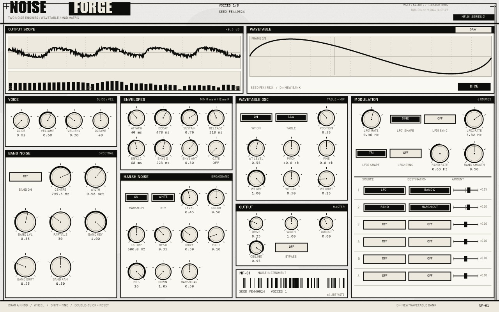

# NOISEFORGE

A noise instrument for VST3 (64-bit Windows): two independent noise engines, a
random wavetable oscillator and a 6-slot modulation matrix, with a printed
white-ink panel.



一个 VST3 噪音合成器乐器：两个完全独立的噪音引擎、一个随机波表振荡器、6 路调制矩阵；面板是白纸黑墨的印刷/复印件风格。

## 特性

- **HARSH NOISE**：8 种噪声（WHITE / PINK / BROWN / BLUE / VIOLET / VELVET / CRACKLE / DIGITAL）+ 谐振 SVF + 折叠 + bitcrush + 降采样。
- **BAND NOISE**：直接正弦加法合成，频段可以完全位于 20 Hz 以下（0.05 Hz 起），没有滤波器建立时间。
- **WAVETABLE OSC**：8 表 × 8 帧 × 4 级 mip，运行时由谐波谱生成；DICE 重建整套波表，种子随工程保存。
- **6 路调制矩阵**：ENV1/2、LFO1/2、RAND、VEL、KEY、GATE、AFTER → PITCH / WT POS / BAND C/W / HARSH CUT/DRV / CRUSH / PAN / LEVEL。
- **防点击**：attack ≥ 8 ms、release ≥ 12 ms、偷 voice 40 ms 淡出、母带 20 ms 淡入、输出 soft-knee + 硬限幅。
- **采样级 MIDI**：note on/off 按 `sampleOffset` 分段渲染，不整块对齐。
- **面板**：纸纹 + 扫描线 + 墨点，黑底反白标题，GDI+ 直接绘制（无位图、无 VSTGUI、无资源文件），1100×688 – 2560×1600 可缩放。

## 安装

把 `dist\NoiseForge.vst3` **整个文件夹**复制到：

```
C:\Program Files\Common Files\VST3\
```

正确的结构是：

```
C:\Program Files\Common Files\VST3\NoiseForge.vst3\Contents\x86_64-win\NoiseForge.vst3
```

宿主里它以 **NoiseForge** 出现在“乐器 / Generators”。

## 构建

需要：

1. **MSYS2 mingw-w64**（`g++` 在 PATH 里，或装在 `C:\msys64\mingw64`）
2. **VST3 SDK**：

```powershell
git clone --recursive https://github.com/steinbergmedia/vst3sdk C:\dev\vst3sdk
```

然后：

```powershell
$env:VST3_SDK = 'C:\dev\vst3sdk'
powershell -ExecutionPolicy Bypass -File build.ps1
```

`build.ps1` 会依次：编译引擎自测 → 链接 `build\NoiseForge.vst3` → 生成 `dist\NoiseForge.vst3` 包 → 宿主模拟测试（35 项）→ 渲染面板到 `build\ui.png` → 跑引擎自测（15 项）。

其他开关：

```powershell
build.ps1 -ToolsOnly        # 只构建自测工具
build.ps1 -SkipTests        # 跳过最后的自测
build.ps1 -Sdk C:\dev\vst3sdk
```

> 插件链接使用 `-static`，把 libstdc++ / libgcc / winpthread 全部静态链进来。**不要**改回 `-static-libgcc -static-libstdc++`：那样 DLL 会依赖 `libwinpthread-1.dll`，宿主在干净机器上加载会直接失败（FL Studio 显示 `error` / 类型未知）。

## 三个音源

### HARSH NOISE —— 粗噪音（宽带）
8 种噪声类型，后接谐振滤波、波形折叠、bit crusher 和采样率降频。每个 voice 独立 RNG（按实例种子播种，两个实例不会重复）。

### BAND NOISE —— 指定频段噪音（频谱合成）
**直接正弦部分音合成**，不是滤波：在任意频段内随机放置最多 96 个正弦部分音。频段可以完全位于 20 Hz 以下（最低 0.05 Hz），没有建立时间、没有 DC 漂移。频段移动时保留已有 partial 的相位，不会爆音。

### WAVETABLE OSC —— 随机波表振荡器
8 表 × 8 帧 × 4 级 mip，运行时由谐波谱生成（概念上参考 Vital 的 WaveSource + Fourier frames 思路，**实现是自写的加法合成，没有使用 Vital 的任何代码**）。每个实例用非确定种子生成自己的波表；DICE（或按 `D`）重建并原子换入，不打断音频线程。

## MIDI

Note On 触发；波表振荡器与 BAND 引擎跟随音高（BAND KEY），**HARSH 引擎本身不做音高跟踪**——要在粗噪音上做音高感，请在调制矩阵里把 `KEY` 接到 `HARSH CUT`。Note Off 进入 release；Poly Aftertouch 驱动 AFTER 源。8 复音；不足时偷取最旧 voice，40 ms 淡出后重新触发排队的音符。

## 防点击设计

- Attack 最低 **8 ms**（线性）
- Release 最低 **12 ms**（指数，60 dB 定义）
- voice 偷取 40 ms 淡出
- master 20 ms 淡入
- Bypass 8 ms 斜坡
- 输出 soft-knee + 硬限幅，Ceiling 是真实上限

## 调制矩阵（6 路）

源：ENV1 / ENV2 / LFO1 / LFO2 / RAND / VEL / KEY / GATE / AFTER
目标：PITCH / WT POS / BAND C / BAND W / HARSH CUT / HARSH DRV / CRUSH / PAN / LEVEL

## 面板

白纸 + 黑墨：纸纹与扫描线是运行时生成的噪点，标题是黑底反白条，参数值是等宽字体；旋钮为墨线圆环 + 指针，悬停整块反白。支持 1100×688 到 2560×1600 缩放。

## 参数（71 个）

| 分组 | 内容 |
|---|---|
| VOICE | Glide, Vel>Amp, Vel>Env, Octave（7 档步进） |
| ENVELOPES | ADSR、ENV2 A/D/AMT、Gate Length |
| WAVETABLE OSC | On, Table, Position, Level, Pitch, Fine, Key, Pan, Drift |
| HARSH NOISE | On, Type, Level, Color, Cutoff, Reso, Drive, Fold, Bits, Down, Pan |
| BAND NOISE | On, Centre, Width, Level, Partials, Key, Drift, Pan |
| MODULATION | LFO1/2 Rate/Shape/Sync, Rand Rate/Smooth, 6 路路由 |
| OUTPUT | Drive, Width, Output, Ceiling, Bypass |

## 文件结构

```
noiseforge/
  src\NoiseForgeCore.h/.cpp    DSP 核心（参数表、RNG、包络、三个音源、引擎）
  vst3\NoiseForgeVST3.cpp      VST3 外壳（参数注册、MIDI、state、工厂）
  vst3\NoiseForgeEditor.h/.cpp GDI+ 编辑器（1280x800，无 VSTGUI、无资源文件）
  tools\selftest.cpp           引擎离线自测
  tools\host_test.cpp          宿主模拟测试
  tools\gui_render.cpp         面板离线渲染（PNG）
  build.ps1                    构建脚本
  docs\screenshot.jpg          面板截图
  FIXLOG.md                    v1.1 修复记录
```

## 线程模型

- 音频线程：`process()` / `noteOn()` / `noteOff()` / `setParam()` —— 无分配、无锁
- UI 线程：窗口过程，只通过 `IParamSink` 通信
- 宿主/自动化：`setParamNormalized()` → 原子变量 + 窗口消息

编辑器永远不碰引擎，音频线程永远不碰编辑器；跨线程状态只有波表双缓冲（原子索引）、参数原子数组和示波器环形缓冲。

## 已知限制

- 建整套波表约 90 ms（8 表 × 8 帧 × 4 mip × 最多 256 谐波），实例化 / 加载工程 / DICE 会卡一下。
- 8 voice 满载约 30–40% 单核（BAND 是 96 partials × 8 的加法合成）。
- HARSH 不做音高跟踪（见上）。
- BAND 的键跟踪参考音是 C4，波表是 A4，二者不同。

## 许可

本项目代码 MIT（见 `LICENSE`）。构建依赖的 [VST3 SDK](https://github.com/steinbergmedia/vst3sdk) 不在仓库内，使用时需遵守 Steinberg 的 VST 3 许可。

“Vital” 是 Xfer Records 的产品名；本项目的波表设计只在概念上参考其 wavetable/frame 思路，未使用其代码，也不含其商标素材。
